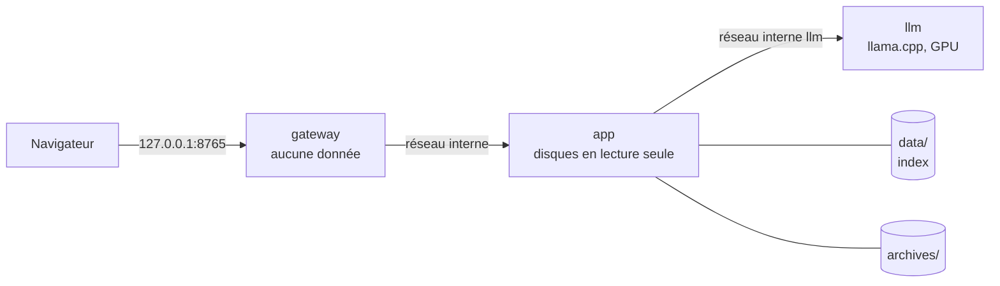

# Architecture

Ce document s'adresse à qui veut lire ou modifier le code. Pour l'usage, voir le [guide](guide/README.md) ; pour le pourquoi de chaque choix, le journal [DECISIONS.md](DECISIONS.md) (les références `D-0xx` y renvoient) ; pour la sécurité, [SECURITY.md](SECURITY.md).

## Vue générale

TreeAudit est une application locale, Linux seulement, en trois couches :

- un **moteur** Python, indépendant de toute interface : analyse, doublons, règles de nettoyage, archives, rangement, projets, IA ;
- deux **interfaces** qui s'appuient sur lui : une **interface web** (FastAPI, pages HTML rendues par Jinja2, un seul fichier JavaScript) et une **ligne de commande** (`argparse`) ;
- un **index** SQLite (bibliothèque standard), qui garde les métadonnées de chaque analyse. Presque tout le reste travaille sur l'index, pas sur le disque.

Deux principes structurent tout le code :

1. **Rien n'écrit sur ce qui est audité.** Seuls l'index (dossier de données) et les archives vérifiées (dossier d'archives) sont écrits (D-024, D-032). Le nettoyage et le rangement passent par des **commandes et des scripts proposés**, que l'utilisateur lance lui-même (D-025).
2. **La sécurité ne dépend pas de Docker** (D-007) : chaque protection existe aussi en mode natif, où le noyau enferme le processus (D-038).

## Carte des modules (`src/treeaudit/`)

| Paquet | Rôle | Fichiers clés |
|---|---|---|
| `core/` | configuration TOML, dossier de données et verrous, bac à sable du noyau, convention des tailles | `config.py`, `datadir.py`, `sandbox.py` (D-038), `sizes.py` (D-047) |
| `roots/` | ce qui peut être audité : validation d'une racine, table des montages, disques externes et partitions de données, dossier personnel | `validation.py` (D-009), `mountinfo.py`, `external.py` (D-033, D-037), `personal.py`, `registry.py` |
| `scanner/` | parcours d'une racine par descripteurs (`O_NOFOLLOW`), sélecteur de dossiers, exécution d'une analyse | `walker.py` (D-013, D-022), `browse.py`, `runner.py`, `models.py` |
| `db/` | schéma et migrations, écriture par lots, lecture des analyses et doublons, cache des résumés | `schema.py`, `connection.py`, `scans.py`, `dupes.py`, `cache.py` |
| `filters/` | recherche : critères, compilation unique des motifs, parcours de l'index en flux | `spec.py`, `search.py` ([FILTERS_AND_REGEX.md](FILTERS_AND_REGEX.md)) |
| `parasites/` | dossiers « à nettoyer » : catalogue de 41 règles, détection sur l'index, confiance expliquée, cache | `rules.toml`, `rules.py`, `detect.py` (D-023), `cached.py` |
| `duplicates/` | doublons exacts : lecture sûre, empreintes en étapes, ordre physique, groupes et copie à garder | `reader.py`, `hashing.py`, `placement.py`, `runner.py` (D-015, D-030), `groups.py` (D-026) |
| `archive/` | archive vérifiée : dossier d'archives, écriture, relecture et comparaison | `destination.py`, `output.py`, `runner.py`, `verify.py` (D-024, D-032) |
| `organize/` | « Ranger » : plan par catégories, ajustements, script de rangement et d'annulation | `plan.py`, `script.py` (D-041) |
| `projects/` | « Projets et logiciels » : inventaire depuis l'index | `detect.py` (D-044) |
| `preview/` | aperçu des images : lecture sûre, type reconnu au contenu | `images.py` (D-046) |
| `llm/` | mode expert : client du serveur local, avis, suggestions, bancs d'essai | `client.py`, `opinion.py`, `organize.py`, `facts.py`, `bench*.py` (D-040) |
| `web/` | interface web : assemblage, pages, API JSON, exports, tâches de fond, sécurité HTTP | voir [Interface web](#interface-web) |
| `shellcmd.py` | **toutes** les commandes de nettoyage proposées, et leur double vérification | D-025, D-045 |
| `cli.py` | ligne de commande ; aussi le serveur web et le relais en Docker | |
| `entry.py` | point d'entrée `treeaudit` : prépare le dossier temporaire de SQLite, puis appelle `cli.main` sous bac à sable en natif | D-038 |
| `gateway.py` | relais TCP entre le port publié et le conteneur `app` | D-020 |
| `bench.py` | mesures de performance, qui n'affichent que des chiffres | |

### Règles de dépendance

- `web/` et `cli.py` dépendent du moteur ; **le moteur ne dépend jamais de `web/`**.
- Écritures sur disque : `db/` et `core/datadir.py` dans le dossier de données ; `archive/output.py` dans le dossier d'archives, et nulle part ailleurs. Aucun autre module n'ouvre un fichier en écriture.
- Aucun module n'exécute de programme : pas de `subprocess`, pas de `os.system` (un test statique le vérifie).
- Le module `llm/` ne reçoit que des métadonnées et ne renvoie que des données validées : il n'a accès à aucune fonction d'écriture ni à aucun outil.
- Une regex ou un nom de dossier ne décide jamais de ce qui peut être lu ou écrit. Les noms disent seulement où regarder ; l'accès est décidé par l'identité (périphérique, inode) et par la validation des racines.

## Deux modes d'exécution

### Docker (par défaut)

Le lanceur `./treeaudit` (bash, D-035) prépare tout **sur l'hôte**, puis appelle `docker compose` :

1. il valide les dossiers demandés et le dossier d'archives avec la table des montages de l'hôte, via les services `check` et `check-archive` (sans réseau ni volume, la table leur est donnée sur l'entrée standard) ;
2. il détecte les disques externes et les partitions de données (service `check-disks`), et écrit un fichier compose qui monte **chaque disque accepté, en lecture seule**, sous `/audit/disks/<id>` ;
3. il démarre `app` et `gateway`, et `llm` en mode expert.

| Service | Rôle | Réseau | Volumes |
|---|---|---|---|
| `app` | serveur web et moteur | interne, sans sortie | disques en lecture seule, `/data`, `/archives` |
| `gateway` | publie le port sur `127.0.0.1` et relaie octet par octet | interne et `edge` | aucun |
| `llm` | serveur llama.cpp (mode expert, `compose.llm.yaml`) | `llm`, interne | `models/` en lecture seule ; seul périphérique : `/dev/dri/renderD128` |
| `check`, `check-disks`, `check-archive` | validations sur l'hôte | aucun | aucun |
| `dev` | tests et outils de qualité | aucun | le dépôt sous `/app` |

Tous les conteneurs tournent avec l'UID et le GID de l'utilisateur, sans capacité Linux (`cap_drop: [ALL]`), avec `no-new-privileges` et un système de fichiers en lecture seule. Le dossier personnel est monté en lecture seule sous `/audit/home`. Dans le conteneur, les disques sont revalidés avant toute analyse.

### Natif (AppImage)

`entry.run` fixe `SQLITE_TMPDIR` **avant** que `sqlite3` soit importé, puis `cli.main(sandboxed=True)` appelle `sandbox.restrict()` avant tout travail :

- **Landlock** : écriture seulement dans les dossiers de données et d'archives ; jamais d'exécution ; réseau limité à l'écoute sur le port de TreeAudit (ABI 4) ; signaux et sockets abstraits limités (ABI 6) ;
- **seccomp** : refuse ce que Landlock ne couvre pas, comme `chmod`, `chown` et les attributs étendus. Il refuse aussi `execve`, `ptrace`, `io_uring`, les sockets autres que TCP, et n'autorise qu'une courte liste d'`ioctl`.

`restrict()` refuse de démarrer si une protection ne peut pas être posée. Toute modification de `core/sandbox.py` ou de ce qui l'appelle doit repasser la sonde `tests/security/test_sandbox.py`, aussi sur l'hôte (règle 17 de CLAUDE.md).

En natif, les disques branchés en cours de route sont détectés à nouveau par `web/live.py` (`refresh_roots`), avec la même validation qu'au démarrage.

## Déroulement des traitements

### Une analyse

1. La racine est revalidée (D-009) ; l'analyse est créée avec l'état `pending`, sous le verrou `scan.lock` (`flock`, partagé avec la ligne de commande).
2. `walker.py` parcourt la racine **itérativement** : une pile de dossiers, chacun ouvert par descripteur depuis son parent avec `O_NOFOLLOW`, puis comparé par `fstat` à ce que la liste annonçait. Un dossier remplacé par un lien entre-temps devient une erreur, jamais un chemin suivi. Les dossiers de TreeAudit et les dossiers privés sont écartés par **identité** (périphérique, inode), jamais par leur nom (D-037).
3. Pour chaque entrée, les métadonnées de `lstat` et le nom **en octets** (`BLOB`, D-014) sont écrits par lots de quelques milliers.
4. L'annulation (`threading.Event`) est vérifiée entre chaque dossier et chaque lot.
5. À la fin, les totaux sont recalculés en SQL sur ce qui a vraiment été écrit, et l'analyse se termine en `complete`, `incomplete`, `cancelled` ou `failed` (D-012). Elle n'annonce jamais plus que ce qu'elle a vu.

### Ce qui travaille sur l'index seulement

Règles de nettoyage, explorateur, panier, recherche, Ranger, Projets : **aucun ne relit le disque**. Une analyse est une photo à un instant donné. Les résultats coûteux d'une analyse terminée sont mis en cache (`summary_cache`) sous une clé qui inclut tout ce dont ils dépendent : identifiant, empreinte du catalogue de règles…

### Ce qui relit le disque

Seules trois fonctions lisent du contenu, toutes avec le même lecteur sûr (`duplicates/reader.py`, `TreeReader`). Chaque dossier est ouvert depuis la racine avec `O_NOFOLLOW`, et le fichier doit être **celui de l'index** (périphérique, inode, taille, date) avant et après la lecture :

- les **doublons** : étapes de plus en plus coûteuses (début, fin, empreinte complète), dans l'ordre physique du disque (`FIEMAP`), en réutilisant les empreintes des fichiers inchangés ;
- les **archives** : écriture sous un nom temporaire, relecture, comparaison membre à membre, publication sans jamais remplacer un fichier ;
- l'**aperçu des images** : octets d'origine, type reconnu aux premiers octets, jamais de SVG.

### Les tâches de fond (`web/jobs.py`)

`JobManager` ne fait tourner **qu'une tâche à la fois**. Une deuxième demande est refusée avec un message, jamais mise en attente. Il existe six sortes de tâches :

| `JobKind` | Lancée par | Résultat |
|---|---|---|
| `SCAN` | `start_scan` | une analyse |
| `DUPES` | `start_dupes` | une recherche de doublons |
| `ARCHIVE` | `start_archive` | une archive vérifiée (verrou `archive.lock`) |
| `SUGGEST` | `start_suggestions` | sous-dossiers proposés par l'IA pour Ranger |
| `OPINIONS` | `start_opinions` | avis de l'IA sur les dossiers à vérifier (50 au plus) |
| `COMPACT` | `start_compact` | `VACUUM` de l'index, sous le verrou des analyses |

Chaque tâche tourne dans un thread, publie sa progression, et se termine avec un résultat (`Outcome`) qui porte l'adresse de la page à afficher. Le JavaScript interroge `/api/jobs/current` à intervalles réguliers et suit chaque sorte de tâche. Les verrous `flock` empêchent une tâche web de tourner en même temps que la même tâche lancée en ligne de commande.

### Une commande proposée

C'est le chemin le plus sensible, celui où une erreur coûterait des données. Il passe toujours par `shellcmd.cleanup_command` :

1. le navigateur n'envoie que des **numéros** (détections, groupes, éléments du panier) ; le serveur relit chaque chemin **dans l'index** ;
2. `cleanup_command(action, cibles, racine, scanned=…, protected=config.protected_paths())` écarte les chemins non affichables, puis passe **chaque cible** dans `check_target` : chemin normalisé, strictement sous le dossier analysé ; ni `/`, ni dossier système, ni dossier personnel entier, ni point de montage, ni racine connue ;
3. le texte est construit : un programme fixe (`gio trash --`, `rm -rf --`, `tar … --`) suivi des chemins passés par `shlex.quote` ;
4. `verify_command` **relit ce texte** avec `shlex.split`. Il doit retrouver exactement le programme et le même nombre de cibles, chacune repassant `check_target`. Sinon, aucune commande n'est donnée (D-045) ;
5. les cibles refusées remontent avec leur raison, affichées à l'utilisateur.

Les commandes de recréation viennent du catalogue `rules.toml`, refusé au chargement s'il contient un programme privilégié ou destructeur. Les scripts de Ranger (`organize/script.py`) refusent tout chemin absolu ou contenant `..`, et n'utilisent que `mv -n` et `rmdir` sur des dossiers vides.

### Le mode expert (`llm/`)

- `client.py` parle au serveur llama.cpp par HTTP, **adresses locales seulement**, et force chaque réponse dans un **schéma JSON**. Ce qui revient est une donnée à valider, jamais une instruction.
- `facts.py` construit ce que l'IA voit d'un dossier : métadonnées de l'index seulement.
- `opinion.py` demande un avis, puis l'**ordre des champs** du schéma oblige le modèle à décrire le contenu avant de conclure. `guard()` corrige ensuite les réponses risquées. L'avis ne change jamais la classification ni la sélection.
- `organize.py` propose des sous-dossiers en deux temps : des noms (vérifiés comme ceux tapés par l'utilisateur), puis une affectation par **énumération fermée**, où le modèle ne peut pas inventer de nom.
- `bench.py`, `bench_heldout.py` et `bench_organize.py` sont les cas d'essai. Le deuxième jeu n'a jamais servi à régler les consignes.

## Modèle de données (`db/schema.py`)

Le schéma en est à la version 4. La version est gardée dans `PRAGMA user_version`. Une migration publiée ne se modifie jamais : on en ajoute une. Une base plus récente que le code est refusée.

| Table | Contenu |
|---|---|
| `scan` | une analyse : racine, sous-dossier, état (D-012), dates, options, compteurs, tailles logique et allouée, cause d'un échec |
| `entry` | une ligne par élément vu : clé `(scan_id, entry_id)`, parent, profondeur, nom et chemin en octets (`BLOB`) et en forme affichable, type, extension, tailles, `mtime_ns`, droits, propriétaire, périphérique, inode, liens, cible d'un lien |
| `dir_summary` | totaux du contenu de chaque dossier entièrement parcouru (D-022) |
| `scan_error`, `scan_exclusion` | éléments illisibles (opération, `errno`) et écartés (point de montage…) |
| `dup_run`, `file_hash`, `dup_error` | recherches de doublons, empreintes (début, fin, complète) d'un inode représentatif, fichiers non lus ; jamais de contenu |
| `summary_cache` | résumés des analyses terminées, sous des clés versionnées |

Index notables : `entry_by_parent` (scan, parent), `entry_by_name`, `entry_by_extension`, `entry_by_identity` (périphérique, inode, pour réutiliser les empreintes).

La base est en mode WAL, avec les clés étrangères actives. Elle est créée avec les droits `0600` : elle contient les chemins des fichiers. « Oublier » une analyse (`forget_scan`) la supprime en cascade avec ses clés de cache, et « Compacter » lance un `VACUUM` (D-043).

### Pièges de performance SQLite

Sur des millions d'entrées, le planificateur de SQLite a plusieurs fois choisi le mauvais index, et une requête d'une seconde en a pris plus de dix minutes. Deux parades sont en place, chacune couverte par un test qui vérifie `EXPLAIN QUERY PLAN` :

- les **CTE récursives** qui descendent une arborescence forcent `CROSS JOIN entry e INDEXED BY entry_by_parent` (`organize/plan.LOAD_SQL`, `parasites/detect`, `projects/detect`, `llm/facts`) ;
- la réutilisation des empreintes force l'ordre de jointure et `INDEXED BY entry_by_identity` (`db/dupes.KNOWN_DIGESTS_SQL`).

Toute nouvelle requête qui parcourt un sous-arbre doit suivre le même modèle.

## Interface web

| Fichier | Rôle |
|---|---|
| `app.py` | `create_app` : assemble les routes et les middlewares ; état partagé dans `app.state` (config, racines, tâches, client IA, détection en direct) |
| `pages.py`, `templates/` | pages HTML ; `render()` ajoute le contexte commun (tâche en cours, archives, bouton Quitter…) |
| `api.py` | API JSON sous `/api/` : tâches, commandes, panier, aperçu d'images ; connexion SQLite par requête (`get_db`) |
| `exports.py` | exports JSON et CSV sous `/export/`, protégés contre l'injection de formules ; scripts de Ranger |
| `jobs.py`, `live.py` | tâches de fond ; disques en direct (natif) |
| `explorer.py`, `queries.py`, `summaries.py`, `search_form.py` | lectures pour l'explorateur, le panier, le bilan et la recherche |
| `security.py` | contrôle de l'en-tête `Host` (contre le DNS rebinding), en-tête `X-TreeAudit-Request` et JSON exigés sur toute requête qui modifie, CSP stricte |
| `static/app.js` | le seul JavaScript : tâches, sélections, commandes, panier, thème ; uniquement `textContent`, jamais de HTML injecté |

Les noms de fichiers viennent des disques audités : ce sont des **données hostiles**. Les gabarits sont rendus avec l'échappement automatique et `StrictUndefined`, jamais avec `|safe`. La CSP interdit tout code en ligne, et `test_web.py` vérifie chaque page avec `assert_safe_html`. La seule image autorisée est l'aperçu servi par TreeAudit lui-même.

FastAPI peut ouvrir la connexion d'une requête dans un thread et exécuter la route dans un autre. La connexion par requête est donc ouverte avec `check_same_thread=False` : elle n'appartient qu'à cette requête (D-046).

## Recettes

### Ajouter une règle de nettoyage

1. Ajoute un bloc `[[rule]]` à `parasites/rules.toml`. Il contient : `id`, `label` et `explanation` en français, `target`, `names` ou `globs`, `base`, et des `evidence` avec un poids. `recreate` donne la commande de recréation (seul paramètre : `{name}`).
2. `rules.py` valide le catalogue au chargement : clés inconnues, motifs, et commandes de recréation sans programme privilégié ni destructeur.
3. Ajoute un cas positif et un cas négatif dans `tests/unit/test_parasite_rules_and_commands.py` ou `tests/integration/test_parasites.py`. Le cache se renouvelle tout seul, car sa clé contient l'empreinte du catalogue.

### Ajouter une page

1. Une route dans `web/pages.py` qui appelle `render(request, "page.html", …)` ; un gabarit qui étend `base.html`.
2. Un test dans `tests/integration/test_web.py` qui passe la page dans `assert_safe_html`, avec un nom de fichier piégé dans l'arborescence de test.
3. Vérifie le rendu en clair, en sombre et à la largeur d'un téléphone (16 px de marge, pas de défilement horizontal).

### Ajouter une tâche de fond

1. Une valeur dans `JobKind`, une méthode `start_…` dans `JobManager`, et un `Outcome` qui porte l'adresse du résultat.
2. Une route `POST` dans `api.py` (le middleware exige l'en-tête anti-CSRF).
3. Le suivi dans `setupJobMonitor` de `static/app.js`.
4. Un test qui lance la tâche et attend sa fin (`client.app.state.jobs.wait()`).

### Proposer une nouvelle commande

Ne construis **jamais** de commande à la main : passe par `shellcmd.cleanup_command`, avec `scanned` (le sous-dossier de l'analyse) et `protected=config.protected_paths()`. Renvoie `result.refused` à l'utilisateur. Ajoute un test avec un nom hostile (`x; sudo rm -rf / #`) relu par `shlex.split`.

## Tests et qualité

`./treeaudit check` lance, dans Docker, `ruff` (lint et format), `mypy` (strict) et `pytest`.

| Dossier | Contenu |
|---|---|
| `tests/unit/` | fonctions pures : règles, commandes et double vérification, filtres, tailles, validation des racines, montages, IA (sans modèle) |
| `tests/integration/` | arborescences synthétiques analysées pour de vrai : analyse, doublons, archives (relues par GNU tar), Ranger (scripts exécutés), projets, aperçu, pages web |
| `tests/security/` | absence d'appels au shell (`test_static_code.py`), conteneurs (`test_compose.py`), lanceur, AppImage, et la **sonde du bac à sable** (`test_sandbox.py`) qui tente 34 actions interdites |

On ne teste jamais sur les vrais dossiers de l'utilisateur : uniquement des arborescences synthétiques, `dummy_folder` et `big_dummy_folder` (un million d'entrées).

## Choix techniques

- Python 3.12 ou plus récent (D-017) ; FastAPI et Uvicorn ; Jinja2. Toute dépendance est justifiée dans [DEPENDENCIES.md](DEPENDENCIES.md).
- Bibliothèque standard pour le reste : `sqlite3`, `hashlib` (SHA-256), `re`, `fnmatch`, `tomllib`, `argparse`, `tarfile`, `logging`, `urllib` (client de l'IA).
- Mode expert : llama.cpp (image Vulkan épinglée par empreinte), Ministral 3 3B en Q4_K_M, contexte de 16 384 jetons, 3,8 Gio de mémoire vidéo mesurés.

## À ne pas anticiper

- Pas de framework frontend ni d'outil de build JavaScript.
- Pas de base de données serveur, de service cloud, ni de file de tâches externe : un thread suffit pour un utilisateur local.
- Pas d'IA qui agit : elle propose, l'utilisateur décide et lance.
- Pas de Windows dans la V1 : son portage est une future V2.
